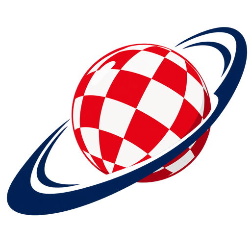

<p align="center">
  
</p>

# OpenGL Boing Ball Demo

A 3D homage to the classic Amiga boing ball demo, implemented in C++ using OpenGL. Features a red and white checkered ball bouncing inside a wireframe cube with physics simulation and sound effects.

## Features

- **Classic Design**: Red and white checkered pattern just like the original Amiga demo
- **Realistic 3D Physics**: Proper ball physics with gravity, velocity, rotation, and accurate collision detection
- **Sound Effects**: Procedurally generated bounce sounds using OpenAL with different pitches for different surfaces
- **Interactive Camera**: Mouse and keyboard controls for viewing the scene from any angle
- **Cross-Platform**: Built with modern OpenGL 3.3 core profile

## Prerequisites

Before building, you need to install the required dependencies:

### macOS

Using Homebrew:
```bash
brew install cmake glfw openal-soft
```

## Building

1. Create a build directory:
```bash
mkdir build
cd build
```

2. Configure with CMake:
```bash
cmake ..
```

3. Build the project:
```bash
make
```

4. Run the demo:
```bash
./BoingBall
```

## Controls

### Keyboard
- **ESC**: Exit the application
- **R**: Reset ball position
- **W/S**: Move camera closer/farther
- **A/D**: Rotate camera left/right
- **Q/E**: Move camera up/down

### Mouse
- **Left Click + Drag**: Rotate camera view

## Project Structure

```
├── CMakeLists.txt          # Build configuration
├── README.md               # This file
├── src/                    # Source code
│   ├── main.cpp           # Main application
│   ├── shader.cpp         # Shader utilities
│   ├── sphere.cpp         # Sphere geometry generation
│   ├── texture.cpp        # Texture generation
│   ├── physics.cpp        # Physics simulation
│   ├── sound.cpp          # Sound system
│   └── cube.cpp           # Cube wireframe geometry
├── include/               # Header files
│   ├── common.h          # Math utilities and common definitions
│   ├── glad.h/.c         # OpenGL function loading
│   └── *.h               # Individual class headers
└── shaders/              # GLSL shaders
    ├── vertex.glsl       # Vertex shader
    ├── fragment.glsl     # Fragment shader for textured objects
    └── wireframe.glsl    # Fragment shader for wireframe
```

## Technical Details

- **Rendering**: OpenGL 3.3 Core Profile with modern shader-based pipeline
- **Geometry**: Procedurally generated UV sphere with proper normals and texture coordinates
- **Physics**: Custom physics engine with collision detection and response
- **Sound**: OpenAL-based sound system with procedurally generated bounce effects
- **Math**: Custom 3D math library for vectors, matrices, and transformations

## Original Amiga Demo

The original Amiga boing ball demo was created by Dale Luck and RJ Mical in 1984. It showcased the Amiga's graphics capabilities with a bouncing ball that demonstrated:
- Hardware sprites
- Smooth animation
- Red and white checkered pattern
- Realistic physics simulation

This OpenGL version pays homage to that classic demo while adding modern 3D graphics and interactivity.

## License

This project is open source and available under the MIT License.
